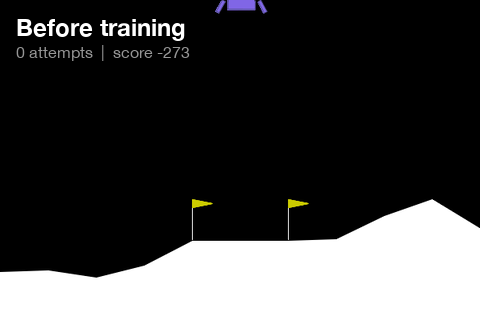

# Project Touchdown

**Teaching an AI to land a rocket. First in a simulator, then for real.**



SpaceX lands rockets on their tail and catches boosters out of the air. I had
no idea how you get a machine to do that, so I started building it myself.

Nobody tells this AI how to fly. It figures it out by trial and error.

## How it learns

The AI controls a lander with three engines: main, left and right. Every
frame it sees eight numbers (position, speed, tilt, which legs touch the
ground) and picks one move. Then it gets points:

| What happens | Points |
|---|---|
| Lands and comes to rest | **+100** |
| Crashes | **-100** |
| Gets closer to the pad, slows down, stays level | a few points, every frame |
| A leg touches the ground | +10 per leg |
| Fires an engine | a small cost, every frame |

After each batch of attempts it nudges its neural network toward the moves
that earned more points. That's it. That is the whole teacher.

## What happened

| Stage | Attempts | What it did |
|---|---|---|
| Before training | 0 | Falls out of the sky |
| Crashing | ~1,000 | Tries to land, mostly crashes |
| **Hovering** | ~2,400 | Found a loophole: if you never land, you can never crash. So it hovered until time ran out. |
| Landing | 3,121 | Lands 19 out of 20 times, average score 239 |

Total training time: about 10 minutes on my laptop.

The hovering phase is my favorite part. The AI did exactly what the points
told it to, not what I meant. Designing those points is called **reward
shaping**, and it is one of the hardest problems in training robots.

## Try it yourself

Python 3.9 or newer.

```bash
git clone https://github.com/ArseniyCherednichenko/project-touchdown.git
cd project-touchdown
python3 -m venv .venv && source .venv/bin/activate
pip install -r requirements.txt
```

Watch my trained AI land:

```bash
python watch.py
```

Watch what happens without a brain, for comparison:

```bash
python watch.py --random
```

Train your own from scratch (about 10 minutes):

```bash
python train.py
```

**Can you beat my score of 239?** Change the settings in `train.py`, train
longer, or rewrite the points. If you beat it, open an issue and tell me how.

## Roadmap

- [x] **Step 1:** Train an AI to land in a 2D simulator
- [ ] **Step 2:** My own rocket simulator with real physics: fuel that burns
      off, a steerable engine, wind
- [ ] **Step 3:** Put the AI on real hardware
- [ ] **Step 4:** A website where you change the points and watch how the AI's
      behavior changes

## Files

| File | What it does |
|---|---|
| `train.py` | Trains the AI and saves snapshots along the way |
| `watch.py` | Opens a window and shows it landing |
| `make_post_media.py` | Renders the GIF above and a phone video from a training run |
| `make_videos.py` | Renders random vs trained side by side |
| `models/lander_ppo.zip` | My trained AI |

Built with [Gymnasium](https://gymnasium.farama.org/) (Lunar Lander) and
[Stable-Baselines3](https://stable-baselines3.readthedocs.io/) (PPO).

## Follow along

I post every step on LinkedIn. Built by Arsenii Cherednichenko.

MIT License.
