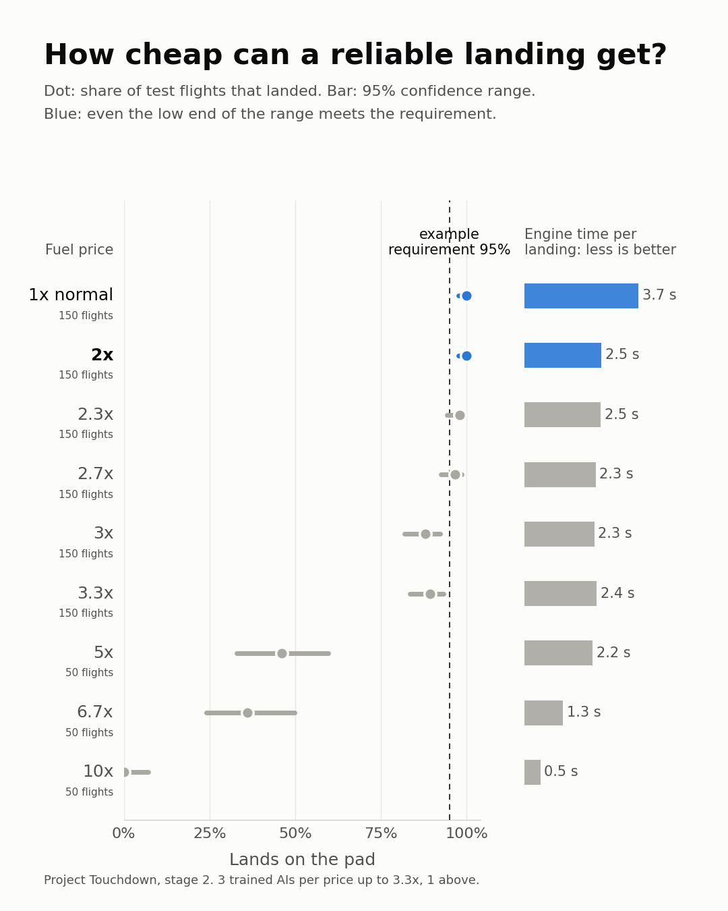

# Project Touchdown

**Teaching an AI to land a rocket. First in a simulator, then for real.**


SpaceX lands rockets on their tail and catches boosters out of the air. I had
no idea how you get a machine to do that, so I started building it myself.

Nobody tells this AI how to fly. It figures it out by trial and error.

## Try it in your browser

No install, free, runs on Google Colab. Each stage is a notebook you can run
step by step.

| Stage | What you do | |
|---|---|---|
| 1. Land a rocket | Train an AI from zero and watch it learn | [](https://colab.research.google.com/github/ArseniyCherednichenko/project-touchdown/blob/main/notebooks/stage1_land_a_rocket.ipynb) |
| 2. Change the points | Watch five AIs trained on different rules, then design your own | [](https://colab.research.google.com/github/ArseniyCherednichenko/project-touchdown/blob/main/notebooks/stage2_change_the_points.ipynb) |

## How it learns

The AI controls a lander with three engines: main, left and right. Every
frame it sees eight numbers (position, speed, tilt, which legs touch the
ground) and picks one move. Then it gets points:

| What happens | Points |
|---|---|
| Lands and comes to rest | **+100** |
| Crashes | **-100** |
| Gets closer to the pad, slows down, stays level | a few points, every frame |
| A leg touches the ground | +10 per leg |
| Fires an engine | a small cost, every frame |

After each batch of attempts it nudges its neural network toward the moves
that earned more points. That's it. That is the whole teacher.

## What happened

| Phase | Attempts | What it did |
|---|---|---|
| Before training | 0 | Falls out of the sky |
| Crashing | ~1,000 | Tries to land, mostly crashes |
| **Hovering** | ~2,400 | Found a loophole: if you never land, you can never crash. So it hovered until time ran out. |
| Landing | 3,121 | Lands 19 out of 20 times, average score 239 |

Total training time: about 10 minutes on my laptop.

The hovering phase is my favorite part. The AI did exactly what the points
told it to, not what I meant. Designing those points is called **reward
shaping**, and it is one of the hardest problems in training robots.

### What I learned

I thought the AI would slowly get better at landing. It didn't. First it
crashed for about 1,700 attempts. Then it found a loophole: if you never land,
you can never crash. So it hovered above the pad until time ran out, for about
900 attempts. I watched it happen live: the flight length jumped to almost
1,000 frames, the time limit, and then suddenly dropped when it figured out
that landing pays more than hovering.

The AI never sees the picture. It only gets 8 numbers: where it is, how fast
it moves, how tilted it is and whether its legs touch the ground. That is
enough. Real rockets work the same way: their sensors give numbers, not video.

What surprised me most is how much is luck. I trained the exact same code
twice. The first AI landed 19 out of 20 times, the second 20 out of 20. One
training run proves very little. I also noticed my random pilot always drifted
to the right. It wasn't chance: the simulator started with the same random push
every time. Small things like that can fool you if you don't check.

## Stage 2: what if I change the points?

Same AI, same training, five different sets of points. Then every AI is
tested on the original rules, 50 flights each.

| Rules | Score | Lands on pad | Crashes | Engine time |
|---|---|---|---|---|
| Normal | 265 | 100% | 0% | 3.2 s |
| Fuel is free | 217 | 100% | 0% | 5.9 s |
| Fuel is 10x expensive | -32 | 0% | 100% | 0.5 s |
| Crashing is free | 277 | 98% | 2% | 2.2 s |
| No hints, only +100 / -100 at the end | -371 | 0% | 100% | 2.8 s |

- **Free fuel:** still lands, but burns almost twice as much.
- **Expensive fuel:** so scared of firing its engine that it barely slows
  down and crashes every time. A rocket has no brakes: the engine is the
  only way to slow down.
- **Crashing is free:** still lands. Crashing ends the flight before the
  +100 for landing, so it avoids crashing anyway.
- **No hints:** never learns. Landing by pure luck is too rare to learn from.
  The small points along the way are what make learning possible.

### The cheapest reliable landing



I trained 3 AIs per fuel price and tested each on 50 flights. The bar is the
95% confidence range: test again and the true landing rate would most likely
fall inside it. Up to 2x the normal fuel price, even the low end of that range
stays above an example requirement of 95%. Script: `fuel_reliability.py`.

### What I learned

The AI doesn't do what you want. It does exactly what you reward. When I made
fuel 10x more expensive, it stopped firing its engine. But a rocket has no
brakes: the engine is the only way to slow down. So it fell almost freely and
crashed every single time. From its point of view, that was the smart move.

Most of my guesses were wrong. I thought free crashing would make it reckless.
It still landed, because a crash ends the flight before the landing bonus can
come. I thought it would quickly learn from just a final reward with no hints.
It never learned anything: it almost never lands by luck, so it never sees the
reward in the first place.

Then I wanted to know the cheapest fuel price that still lands reliably. With
three training runs per price, up to 2x the normal price it still landed every
time and used about a third less engine. Past that it barely saved more fuel,
but it started missing. Near the limit the runs disagreed with each other: one
landed 74% of the time, another 98%, with the same settings. That is why
engineers don't design right at the edge. They keep a margin.

One training run per variant, so treat the exact numbers as rough. Run it
yourself: `python train_variants.py free_fuel`, then
`python train_variants.py compare`.

## Run it on your own computer

Python 3.9 or newer.

```bash
git clone https://github.com/ArseniyCherednichenko/project-touchdown.git
cd project-touchdown
python3 -m venv .venv && source .venv/bin/activate
pip install -r requirements.txt
```

Watch my trained AI land:

```bash
python watch.py
```

Watch what happens without a brain, for comparison:

```bash
python watch.py --random
```

Train your own from scratch (about 10 minutes):

```bash
python train.py
```

**Can you beat my score of 239?** Change the settings in `train.py`, train
longer, or rewrite the points. If you beat it, open an issue and tell me how.

## Roadmap

- [x] **Stage 1:** Train an AI to land in a 2D simulator
- [x] **Stage 2:** Change the points and see what breaks
- [ ] **Stage 3:** My own rocket with real physics: fuel that burns off, an
      engine that tilts to steer, wind
- [ ] **Stage 4:** AI vs a hand-written controller, the way engineers do it
- [ ] **Stage 5:** A website: land it yourself, then watch the AI, and change
      the rules with sliders
- [ ] **Stage 6:** Tower catch: fly into the arms instead of landing on legs
- [ ] **Stage 7:** Real hardware

## Files

| File | What it does |
|---|---|
| `train.py` | Trains the AI and saves snapshots along the way |
| `watch.py` | Opens a window and shows it landing |
| `make_post_media.py` | Renders the GIF above and a phone video from a training run |
| `rewards.py` | Every point value as a setting, plus the stage 2 variants |
| `train_variants.py` | Trains and compares the variants |
| `make_variant_video.py` | Renders the stage 2 video |
| `sweep_fuel.py`, `fuel_chart.py`, `fuel_reliability.py` | Fuel price check: train, test, chart |
| `hud.py` | Telemetry panel: what the AI sees and decides while it flies |
| `make_videos.py` | Renders random vs trained side by side |
| `notebooks/stage1_land_a_rocket.ipynb` | Stage 1 step by step, runs in Colab |
| `notebooks/stage2_change_the_points.ipynb` | Stage 2: five sets of points, then your own |
| `models/variants/` | The five stage 2 AIs |
| `models/lander_ppo.zip` | My trained AI |

Built with [Gymnasium](https://gymnasium.farama.org/) (Lunar Lander) and
[Stable-Baselines3](https://stable-baselines3.readthedocs.io/) (PPO).

## Follow along

I post every step on LinkedIn. Built by Arsenii Cherednichenko.

MIT License.
